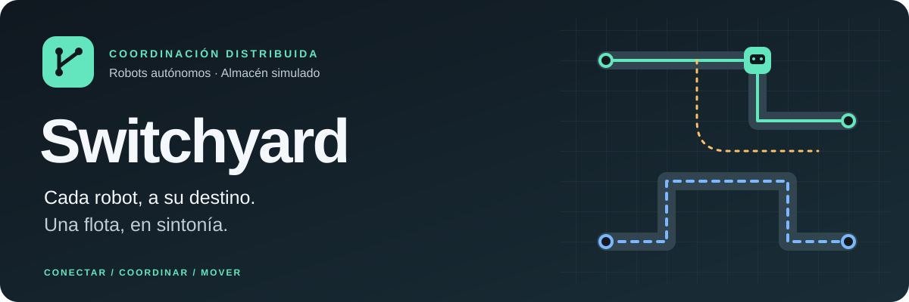
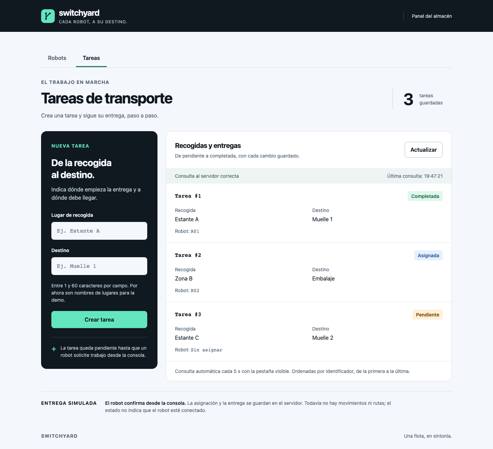
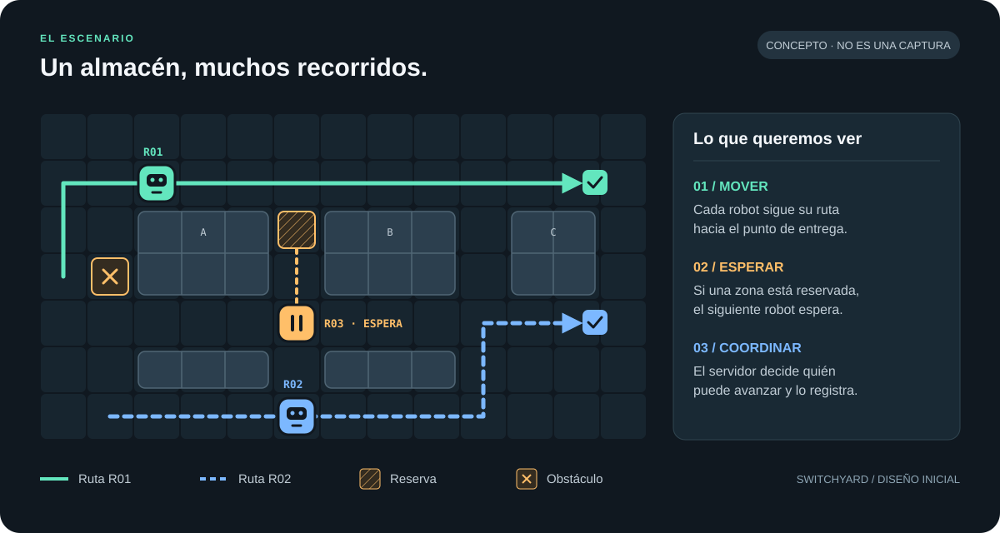
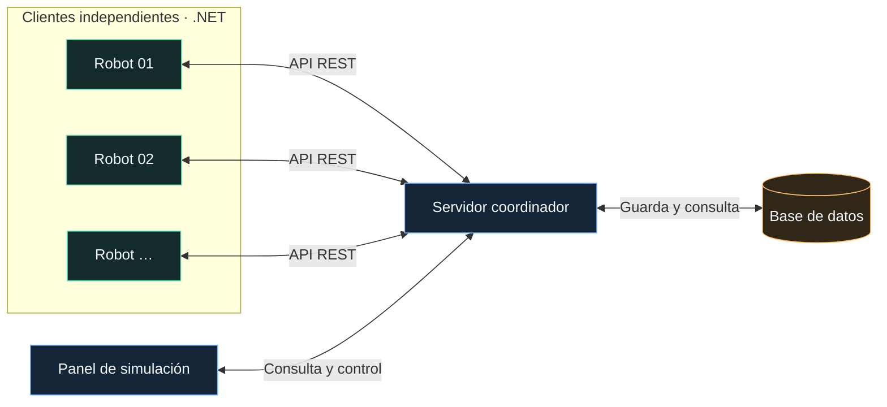
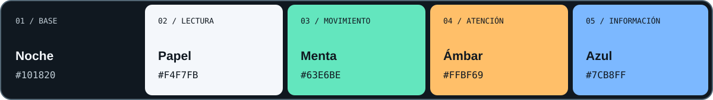

<p align="center">
  
</p>

<p align="center">
  <strong>Coordinación distribuida de robots autónomos en un almacén simulado.</strong><br>
  Procesos independientes. Rutas compartidas. Trabajo en equipo.
</p>

<p align="center">
  <a href="#la-idea">La idea</a> ·
  <a href="#cómo-encaja-todo">Cómo funciona</a> ·
  <a href="#la-demo-que-queremos-construir">La demo</a> ·
  <a href="#por-dónde-empezamos">Hoja de ruta</a> ·
  <a href="docs/flujo-de-trabajo.md">Cómo trabajamos</a> ·
  <a href="docs/README.md">Documentación técnica</a>
</p>

> **Ya puedes probarlo:** registra robots desde el panel web o desde el cliente .NET. Crea tareas desde el panel y sigue cómo el cliente .NET las recoge y confirma su entrega simulada. SQLite conserva las altas y las tareas. El mapa, el movimiento y las rutas siguen pendientes.

## La idea

Un robot necesita cruzar un pasillo. Otro viene de frente. Un tercero se ha quedado parado justo en la salida.

Por separado, llevar una caja de un sitio a otro parece sencillo. Cuando varios robots comparten espacio, hacen falta acuerdos: quién pasa primero, dónde espera cada uno y qué hacemos si alguien deja de responder.

**Switchyard es el coordinador de ese almacén.** Cada robot será una aplicación cliente en .NET, ejecutada como un proceso independiente y conectada a un servidor mediante una API REST. El servidor organizará las tareas y los desplazamientos, y una base de datos conservará el estado del sistema.

No necesitaremos robots físicos: veremos su actividad en una simulación. Eso nos permitirá introducir obstáculos, provocar fallos y observar cómo responde el conjunto.

El nombre viene de los patios ferroviarios donde se organizan trenes y desvíos. Aquí cambiamos las vías por pasillos y los trenes por robots, pero la idea es la misma: coordinar muchos movimientos para que cada uno llegue a su destino.

## Qué queremos conseguir

| En el almacén… | Switchyard deberá… |
| :--- | :--- |
| Hay pedidos por mover. | Asignar tareas a los robots disponibles. |
| Varios robots necesitan el mismo pasillo. | Organizar turnos para que no ocupen un espacio incompatible. |
| Aparece un obstáculo. | Buscar una ruta alternativa o esperar si no hay paso. |
| Un robot deja de responder. | Detectar la pérdida de comunicación y gestionar su tarea sin dar por libre su posición. |
| Queremos saber qué ha pasado. | Guardar el estado y los eventos relevantes para poder consultarlos. |

Nace como un proyecto de **Sistemas Distribuidos y Programación en Paralelo**, desarrollado en pareja. Queremos que también tenga sitio en un portfolio: un problema reconocible, decisiones que podamos explicar y una demostración reproducible.

El caso de uso se inspira en la logística real. El resultado será un prototipo educativo; operar maquinaria física exigiría otras garantías y validaciones.

## El panel que ya funciona



*Captura real con datos de demostración. En **Robots** registras los clientes; en **Tareas** preparas recogidas y destinos y sigues sus estados. Los datos permanecen al reiniciar. Un registro o una asignación no prueban que el robot siga conectado.*

## Un vistazo al almacén



*Vista conceptual. Los colores y las etiquetas distinguen rutas, reservas y obstáculos. El panel definitivo se construirá durante el desarrollo.*

Nos gustaría que la actividad se entendiera de un vistazo: qué está haciendo cada robot, qué zonas están ocupadas y por qué alguien tiene que esperar. La simulación será también nuestra forma de explicar lo que ocurre por debajo.

## Cómo encaja todo



- **Los robots** pedirán trabajo, comunicarán su posición y solicitarán permiso para avanzar. Cada uno tendrá su propio proceso y podrá desconectarse de forma independiente.
- **El servidor** mantendrá una visión común del almacén: tareas, rutas y reservas de espacio. Tener una ruta calculada no significará tener permiso para recorrerla sin más.
- **La base de datos** conservará el mapa, las tareas, el último estado conocido de los robots y los eventos necesarios para seguir la actividad. Al reiniciar, habrá que comprobar ese estado antes de reanudar movimientos.
- **El panel** permitirá ver la simulación y preparar escenarios. El cliente .NET exigido por la asignatura será cada robot; el panel web es una interfaz adicional, construida con HTML, CSS y JavaScript.

La primera entrega usa **REST con mensajes JSON**, un servidor **ASP.NET Core sobre .NET 10** y **SQLite**. El panel inicial se sirve desde la misma API, sin instalar otro servidor. Las decisiones y sus motivos están en la [documentación técnica](docs/README.md).

### Dónde entra el trabajo en paralelo

Hay dos retos distintos. Por un lado, muchos robots se comunicarán y avanzarán de forma concurrente. Por otro, queremos que el servidor pueda **calcular varias rutas en paralelo** cuando reciba varias peticiones.

Después habrá que comprobar que esas rutas pueden convivir. Dos cálculos correctos por separado pueden proponer el mismo pasillo a la vez: coordinar las reservas es lo que convierte las rutas individuales en un plan compartido.

## La demo que queremos construir

La exposición debería contar una historia que se pueda seguir sin leer el código:

1. **Abrimos el almacén.** Cargamos un mapa pequeño con estanterías, puntos de recogida y destinos.
2. **Arrancamos diez robots.** Cada uno se conecta desde su propio proceso .NET. El panel muestra cómo se incorporan.
3. **Les damos trabajo.** Aparecen tareas y vemos cómo se reparten, se mueven y esperan cuando comparten un paso.
4. **Cambiamos el escenario.** Añadimos un obstáculo en una celda libre. Los robots afectados deberán recalcular o esperar.
5. **Desconectamos un robot.** El servidor detecta su ausencia. En el escenario de demostración, una tarea de recogida aún no iniciada podrá pasar a otro robot; su última posición seguirá tratándose con cautela.
6. **Revisamos lo ocurrido.** Consultamos las tareas y los eventos guardados para explicar las decisiones del sistema.

Queremos poder repetir esta demo con un escenario preparado, comprobar el resultado y responder con el código delante: quién decide, qué se guarda y qué ocurre cuando dos peticiones llegan a la vez.

## Por dónde empezamos

El mayor riesgo del proyecto es intentar resolver toda la robótica de un almacén antes de tener una aplicación que funcione. Por eso empezaremos con **un mapa en cuadrícula, movimientos por turnos y un único servidor coordinador**. Los robots serán procesos separados desde el principio.

| Etapa | Qué queremos ver funcionando |
| :--- | :--- |
| **0 · Presentarnos al servidor — disponible** | Un cliente .NET registra un robot; la API permite consultarlo y conserva el alta en SQLite. |
| **0.1 · Un panel para empezar — disponible** | Alta y listado desde el navegador, consultas periódicas y diseño adaptable. |
| **1 · Una entrega completa — disponible** | Creamos la tarea en el panel, un cliente .NET la solicita y confirma su entrega; el panel muestra los cambios guardados. |
| **2 · Un almacén compartido** | Varios robots se desplazan con reservas de espacio y esperas visibles. |
| **3 · Rutas en paralelo** | El servidor calcula varias rutas a la vez; medimos el resultado frente al cálculo secuencial. |
| **4 · Cuando algo falla** | Introducimos obstáculos y desconexiones, detectamos bloqueos y probamos una recuperación acotada. |
| **5 · Una demo reproducible** | Arrancamos diez procesos, mostramos el panel y documentamos cómo repetir el escenario. |

El registro, el panel y el flujo de una tarea están implementados. Las etapas 2 a 5 siguen previstas. Para la primera versión quedan fuera los robots físicos, los mapas 3D, el aprendizaje automático y la alta disponibilidad del servidor. Preferimos una simulación pequeña que podamos entender, medir y defender bien.

### Una idea para más adelante: el almacén en el bolsillo

Como ampliación **opcional**, un empleado podría consultar desde el móvil los robots y sus rutas, y un revisor autorizado podría realizar cambios acotados, como señalar una incidencia. Primero terminaremos la simulación y la demo principal.

El panel ya se diseña para pantallas pequeñas, así que este objetivo no nos obliga a crear una app móvil. Las vistas de actividad, las cuentas y los permisos todavía no existen; permitir editar requerirá comprobar la autorización en el servidor. Los detalles y límites están en la [arquitectura](docs/arquitectura.md#ampliación-opcional-acceso-desde-el-móvil).

## Estado del repositorio y puesta en marcha

Necesitas el **SDK de .NET 10**. Desde la raíz del repositorio, compila y arranca la API en una terminal:

```bash
dotnet build Switchyard.sln --configuration Release
dotnet run --project src/Switchyard.Api --configuration Release --no-build -- --urls http://localhost:5080
```

Abre [el panel de Switchyard](http://localhost:5080) para registrar robots. La sección **Tareas** permite crear recogidas y destinos y seguir su estado. No necesitas Node ni instalar un frontend aparte.

También puedes registrar un robot desde el cliente .NET. En otra terminal, desde la raíz:

```bash
dotnet run --project src/Switchyard.Robot --configuration Release --no-build -- R01 http://localhost:5080
```

El cliente muestra la confirmación y termina. Con el panel visible, el registro aparecerá en una próxima consulta automática; también puedes pulsar **Actualizar**. La [lista en JSON](http://localhost:5080/api/robots) sigue disponible. Si repites el alta de `R01`, la API indica que ya existe; puedes probar con `R02`.

Puedes detener la API con `Ctrl+C`, volver a arrancarla con el mismo comando y consultar de nuevo la lista para comprobar que el alta sigue guardada. Para crear una tarea en el panel y completarla desde la consola, sigue la [demo paso a paso](docs/ejecucion.md#demo-completa-del-panel-a-la-consola).

La [guía de ejecución](docs/ejecucion.md) explica las pruebas, la configuración y la demo paso a paso. Para entender el código y preparar la exposición, empieza por [el registro](docs/funcionalidades/01-registro-de-robots.md), [el panel de robots](docs/funcionalidades/02-panel-web.md) y [el panel de tareas](docs/funcionalidades/04-panel-de-tareas.md).

Por ahora puedes explorar:

```text
switchyard/
├── README.md                 Presentación del proyecto
├── AGENTS.md                 Contexto e instrucciones para asistentes de IA
├── Switchyard.sln            Solución .NET
├── src/                      API, cliente robot y contratos de mensajes
├── tests/                    Pruebas de API, persistencia y cliente
├── .github/                  Plantillas y comprobaciones automáticas
└── docs/
    ├── README.md             Índice de documentación técnica
    ├── ejecucion.md          Arranque, pruebas y demostración
    ├── funcionalidades/      Explicación del código y preguntas para la defensa
    ├── criterios-de-codigo.md Convenciones para desarrollar por partes
    ├── flujo-de-trabajo.md    Acuerdo de colaboración y entrega
    ├── arquitectura.md       Propuesta inicial y decisiones pendientes
    ├── identidad-visual.md   Colores, símbolo y uso de los recursos
    └── assets/               Ilustraciones SVG e isotipo en SVG y PNG
```

## Cómo trabajamos

Cada tarea tendrá una issue con responsable, una rama propia y commits que permitan seguir su historia. Las ramas de tarea salen de `develop` y vuelven mediante un pull request revisado por el compañero. Cuando el conjunto esté validado, otro PR promociona `develop` a `main`, nuestra versión estable. Así podremos saber qué se hizo, por qué y cómo se comprobó.

La [guía de trabajo](docs/flujo-de-trabajo.md) explica el proceso con ejemplos y recoge la excepción de esta primera entrega de documentación. Incluimos plantillas para facilitar las tareas y revisiones, y un [AGENTS.md](AGENTS.md) para que los asistentes de IA compartan el mismo contexto.

## Una identidad para Switchyard



La identidad toma prestado el lenguaje de la señalización: líneas claras, recorridos y puntos de encuentro. El símbolo representa un desvío con tres terminales. La menta acompaña el movimiento, el ámbar señala las esperas y el azul identifica información del sistema. Los estados también llevarán texto o símbolos para que el color no sea la única pista.

Los recursos están incluidos en el repositorio y se pueden editar sin depender de un servicio externo. La [guía de identidad](docs/identidad-visual.md) recoge la paleta y sus usos.

Para usar el símbolo como imagen de perfil, descarga el [isotipo en PNG](docs/assets/switchyard-avatar.png). También está disponible [sin fondo](docs/assets/switchyard-symbol.png) para presentaciones y documentos.

---

**Cada robot, a su destino. Una flota, en sintonía.**
