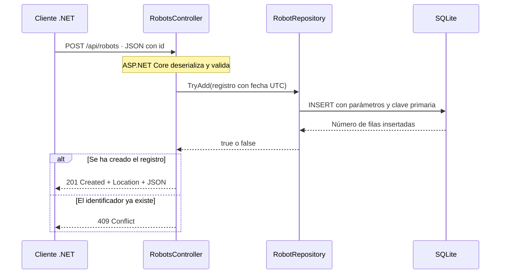

# 01 · Registro de robots

**Implementado en la issue [#6](https://github.com/switchyard-project/switchyard/issues/6).** Esta es una primera pieza completa del sistema: un proceso cliente registra un identificador, recibe la respuesta de otro proceso y el servidor conserva el alta en disco.

No hay movimiento, tareas de transporte, posiciones, reservas, señales de actividad ni cálculo paralelo. El cliente termina después del alta. Un registro existente **no significa que el robot esté conectado**.

## Qué podemos demostrar

La [guía de ejecución](../ejecucion.md) contiene los comandos. En unos minutos podemos arrancar la API, registrar `R01` con el cliente .NET, consultar el resultado en el navegador, repetir el alta para observar un conflicto y reiniciar el servidor para comprobar que el dato permanece.

## Recorrido de una petición



El cliente no carga la clase del controlador ni abre SQLite. Envía bytes mediante HTTP; el servidor los interpreta como JSON y construye sus propios objetos. Compartir un proyecto de contratos no significa compartir memoria entre procesos.

## Contrato HTTP

### Dar de alta

`POST /api/robots` con `Content-Type: application/json`:

```json
{
  "id": "R01"
}
```

El identificador tiene de 1 a 32 caracteres ASCII: `A-Z`, `0-9`, `-` y `_`. Debe empezar por una letra o un número. Las minúsculas se rechazan, no se convierten. El servidor asigna la fecha; el cliente no puede elegirla.

Una respuesta de éxito es `201 Created`, con `Location` apuntando a `/api/robots/R01` y este cuerpo. La fecha es ilustrativa:

```json
{
  "id": "R01",
  "registeredAt": "2026-11-25T12:00:00+00:00"
}
```

Si el identificador ya existe, devuelve `409 Conflict` sin modificar el registro original. Un cuerpo ausente, mal formado o con identificador inválido devuelve `400 Bad Request`. Si se envía un cuerpo con un tipo de contenido no admitido, el framework puede devolver `415 Unsupported Media Type`.

### Consultar

| Petición | Resultado |
| :--- | :--- |
| `GET /api/robots` | `200 OK` y un array ordenado por identificador; `[]` si no hay registros. |
| `GET /api/robots/R01` | `200 OK` y el objeto registrado. |
| `GET /api/robots/UNKNOWN` | `404 Not Found`. |

Los errores de validación usan `ValidationProblemDetails`; el conflicto y la consulta inexistente usan `ProblemDetails`. El cliente se guía por el estado HTTP, sin depender del texto exacto del error. `GET` no modifica el estado.

## Dónde está cada cosa

| Archivo | Responsabilidad |
| :--- | :--- |
| [API · Program.cs](../../src/Switchyard.Api/Program.cs) | Configura HTTP, controladores, manejo de errores e inyección de dependencias; prepara el almacenamiento y arranca el servidor. |
| [RobotsController.cs](../../src/Switchyard.Api/Controllers/RobotsController.cs) | Recibe las operaciones de registro y consulta y construye las respuestas HTTP. |
| [RobotRepository.cs](../../src/Switchyard.Api/Data/RobotRepository.cs) | Ejecuta SQL sobre SQLite. No conoce códigos HTTP. |
| [RegisterRobotRequest.cs](../../src/Switchyard.Contracts/RegisterRobotRequest.cs) | Describe el mensaje de alta y sus restricciones de validación. |
| [RobotResponse.cs](../../src/Switchyard.Contracts/RobotResponse.cs) | Describe los datos que se devuelven: identificador y fecha. |
| [Cliente · Program.cs](../../src/Switchyard.Robot/Program.cs) | Lee argumentos, configura `HttpClient`, muestra el resultado y traduce errores a mensajes y códigos de salida. |
| [RobotApiClient.cs](../../src/Switchyard.Robot/RobotApiClient.cs) | Envía el alta de forma asíncrona y comprueba que la respuesta sea interpretable y corresponda al robot solicitado. |

### Métodos que conviene saber explicar

| Método | Entrada, trabajo y resultado |
| :--- | :--- |
| `RobotsController.Register` | Recibe una solicitud ya validada, crea la fecha UTC e intenta insertar. Devuelve `201` o `409`. |
| `RobotsController.GetById` | Recibe el identificador; devuelve el registro o `404`. |
| `RobotsController.GetAll` | Devuelve los registros que obtiene del repositorio. |
| `RobotRepository.Initialize` | Crea el directorio y, si falta, la tabla; activa WAL. Se ejecuta antes de aceptar peticiones. |
| `RobotRepository.TryAdd` | Intenta una única inserción parametrizada. Devuelve `true` si se insertó una fila y `false` si ya existía el identificador. Otros fallos no se ocultan como duplicados. |
| `RobotRepository.GetById` | Hace un `SELECT` parametrizado; devuelve `RobotResponse` o `null`. |
| `RobotRepository.GetAll` | Lee el resultado ordenado y lo convierte en una lista. |
| `RobotRepository.ReadRobot` | Convierte las columnas de una fila en la respuesta tipada y recupera la fecha con formato independiente del idioma del equipo. |
| `RobotApiClient.RegisterAsync` | Serializa la solicitud, espera el HTTP, comprueba el estado y deserializa la respuesta. Propaga errores y acepta cancelación. |
| `Switchyard.Robot.Program.Main` | Valida los argumentos y la URL, realiza un alta y termina con `0` si tuvo éxito o `1` si falló. |

Los constructores reciben sus dependencias. El contenedor de ASP.NET Core entrega el repositorio al controlador; en el cliente, `Main` crea el `HttpClient` y se lo pasa a `RobotApiClient`.

## Estado y concurrencia

La tabla contiene dos columnas:

| Columna | Restricción y sentido |
| :--- | :--- |
| `id` | `TEXT PRIMARY KEY NOT NULL`: identidad única del registro. |
| `registered_at` | `TEXT NOT NULL`: fecha UTC del alta, serializada con formato `O` de .NET. |

La inserción utiliza `ON CONFLICT(id) DO NOTHING`. La decisión de si el identificador está libre y su inserción se resuelven dentro de la base de datos. No hacemos primero un `SELECT` y luego un `INSERT`: dos peticiones podrían superar esa comprobación al mismo tiempo. Si compiten por el mismo identificador, una inserta y las demás obtienen conflicto. [Sintaxis UPSERT de SQLite](https://www.sqlite.org/lang_upsert.html).

No necesitamos un `lock` alrededor de una lista en memoria: la lista no es la fuente de verdad. Un `lock` de C# solo protegería el proceso que lo contiene. Tampoco hemos resuelto con esto las futuras reservas de celdas o los interbloqueos de movimiento.

El repositorio se registra como `singleton`, pero solo conserva dos cadenas inmutables: ruta y conexión. Cada operación crea y cierra su propia conexión, comando y lector mediante `using`. No comparte una conexión mutable entre peticiones. Desactivamos el pool para que el cierre sea directo; para esta demo prima la sencillez sobre ahorrar aperturas.

WAL permite que lecturas y escrituras convivan mejor, pero SQLite sigue teniendo un único escritor a la vez. El proveedor espera hasta cinco segundos ante bloqueos según la configuración de conexión. No prometemos capacidad para una flota de producción ni alta disponibilidad.

## Decisiones de esta entrega

| Decisión | Motivo y límite |
| :--- | :--- |
| .NET 10 para API y cliente | Está disponible en el entorno de trabajo y permite desarrollar ambos en C#. No usamos .NET Framework ni dependencias de Windows Forms. |
| ASP.NET Core con controladores | Mantiene visibles las clases y métodos de cada operación, con validación integrada. Hay pocos endpoints y no necesitamos otra capa que solo reenvíe llamadas. |
| REST y JSON | Coincide con la propuesta y con los conceptos del ejercicio de cliente REST. El contrato se puede consumir desde otros lenguajes. |
| SQLite y SQL directo | Permite comprobar persistencia sin instalar otro servicio; una tabla y cuatro operaciones no necesitan todavía un ORM. Cuando cambie el esquema habrá que planificar migraciones. |
| Contratos compartidos | Evita duplicar los tipos entre nuestros dos proyectos .NET. El intercambio en ejecución sigue definido por JSON, no por objetos remotos. Cambiar los contratos obliga a cuidar la compatibilidad entre versiones. |
| `POST` con duplicados `409` | Expresa un alta y hace explícito que un identificador ya existe. No implementamos actualización ni reintentos automáticos. |
| Fecha en el servidor | La fecha identifica el momento del alta según su reloj. UTC facilita interpretarla, pero no crea un reloj global ni garantiza orden causal entre máquinas. |
| `HttpClient` durante toda la ejecución del cliente | La misma instancia concentra configuración y conexión; no se crea un cliente nuevo por cada llamada. El proceso actual solo hace una petición. |

`[ApiController]` activa, entre otras cosas, la validación automática de modelos: si las anotaciones del identificador fallan, se responde antes de entrar en `Register`. `CreatedAtAction` construye la respuesta de creación y la dirección del recurso. [Controladores de ASP.NET Core](https://learn.microsoft.com/en-us/aspnet/core/web-api/?view=aspnetcore-10.0).

Las operaciones de red usan `async/await`; las de SQLite son síncronas. No envolvemos el SQL en `Task.Run` ni le añadimos `Async` al nombre: el proveedor `Microsoft.Data.Sqlite` no realiza E/S asíncrona real. Para este registro pequeño asumimos ese bloqueo durante el acceso al archivo. [Limitaciones asíncronas del proveedor](https://learn.microsoft.com/en-us/dotnet/standard/data/sqlite/async).

## Pruebas y qué demuestran

[RobotRegistrationTests](../../tests/Switchyard.Tests/RobotRegistrationTests.cs) arranca la API con `WebApplicationFactory` y una base SQLite temporal distinta por caso. Las peticiones recorren serialización, validación, controlador y repositorio. El transporte de ese servidor de pruebas es interno al proceso; no sustituye a comprobar el puerto real.

- Creación con estado `201`, cuerpo JSON, fecha UTC y cabecera `Location` consultable.
- Identificadores válidos en sus límites y entradas inválidas, incluidos valores ausentes, minúsculas, saltos de línea y cuerpos mal formados.
- Listado vacío, listado ordenado, consulta inexistente y duplicado sin alterar el alta original.
- Diez solicitudes concurrentes con el mismo identificador: una creación, nueve conflictos y una fila.
- Destrucción del servidor de pruebas y creación de otro sobre el mismo archivo: el registro permanece.

[RobotApiClientTests](../../tests/Switchyard.Tests/RobotApiClientTests.cs) usa respuestas HTTP controladas para comprobar que el cliente no informe de éxito con JSON incorrecto, campos ausentes o un identificador distinto del solicitado. No hay una base simulada en las pruebas de persistencia.

En la validación inicial del 25 de noviembre de 2026 pasaron **30 casos de prueba en macOS ARM64**, usando SDK `10.0.401`. También se ejecutaron procesos reales de API y cliente, errores de uso y de conexión, diez peticiones concurrentes por TCP y una parada y arranque del servidor conservando el archivo. El formato se comprobó con `dotnet format`. Los resultados de CI en otras plataformas se revisan en el PR; este dato local no los sustituye.

## Preguntas para preparar la exposición

**¿Qué parte es distribuida si lo ejecutamos en un solo Mac?**

API y cliente tienen procesos y memoria independientes y se comunican mediante mensajes HTTP. La demo local usa la interfaz de loopback. Para demostrar distribución física podemos ejecutar el cliente en otro equipo cambiando la URL; eso no requiere que comparta el disco del servidor.

**¿Dónde está el requisito de cliente .NET?**

En `Switchyard.Robot`, que es un ejecutable C#. El navegador solo sirve aquí para observar las consultas; no sustituye al cliente de la asignatura.

**¿REST es un protocolo? ¿Por qué no usamos sockets directamente?**

REST es un estilo arquitectónico; HTTP transporta nuestras peticiones. El servidor web gestiona el transporte y nosotros definimos recursos, métodos y respuestas. Los ejercicios con sockets ayudan a entender lo que hay debajo, pero no necesitamos volver a implementar ese nivel.

**¿Cómo puede ser stateless y guardar datos?**

Cada petición lleva la información necesaria y no depende de una sesión de conversación anterior. Los registros de negocio sí se conservan en la base de datos. Stateless no significa perder los datos al reiniciar.

**¿Por qué `POST` y por qué `201`?**

Estamos solicitando crear un registro. `201` comunica que se ha creado y `Location` señala dónde consultarlo. El `409` indica que el estado actual entra en conflicto con el alta pedida.

**¿El alta garantiza exactamente una ejecución?**

No. La clave primaria evita registros duplicados, pero pueden llegar varias peticiones. Si la respuesta se pierde, el cliente puede no saber si la primera se guardó. Debe consultar el identificador antes de decidir qué hacer; no prometemos entrega «exactamente una vez» ni llamamos idempotente a cualquier `POST`.

**¿Qué ocurre si dos robots usan el mismo identificador?**

La base admite un único registro. No podemos distinguir si son dos procesos diferentes o un reintento del mismo robot. La autenticación y la identidad de las futuras sesiones de actividad están fuera de esta entrega.

**¿Qué diferencia hay entre `Task`, hilo y proceso?**

Un proceso tiene su propio espacio de memoria. Sus hilos comparten memoria dentro de él. Una `Task` representa una operación y su resultado eventual; no equivale siempre a un hilo dedicado. `await` espera la respuesta HTTP sin bloquear un hilo mientras la operación está pendiente.

**¿Ya hay programación en paralelo?**

Todavía no hay cálculo paralelo de rutas. Hemos comprobado concurrencia de peticiones y usado asincronía en red. `Task.Run` aparece en una prueba para provocar solicitudes competidoras; no constituye la funcionalidad paralela del producto.

**¿Por qué SQL con parámetros si ya validamos el identificador?**

Porque cada mecanismo tiene una responsabilidad: la validación establece el formato del negocio; los parámetros mantienen los datos separados del código SQL. No dependemos de que una validación futura siga prohibiendo ciertos caracteres.

**¿Qué significa `record`? ¿Y `sealed`?**

`RobotResponse` es un tipo orientado a datos, con propiedades inicializadas al construirlo e igualdad por sus valores. `sealed` impide heredar de estos tipos; no necesitamos extenderlos mediante herencia para este caso.

**¿Por qué inyección de dependencias sin una interfaz de repositorio?**

El controlador recibe lo que necesita por el constructor, sin crearlo ni conocer su configuración. Solo hay un almacenamiento y probamos contra él. Una interfaz será útil si aparece otra implementación o una necesidad real de separación; hoy añadiría otra pieza que mantener.

**¿Qué hace `public partial class Program` al final de la API?**

Expone el punto de entrada generado por las instrucciones de nivel superior para que `WebApplicationFactory<Program>` pueda arrancar la aplicación real durante las pruebas. No inicia un segundo servidor por sí sola.

**¿Qué pasa si el servidor o el disco fallan?**

El cliente informa de un error HTTP, de conexión o de tiempo de espera. Los fallos inesperados se registran en el servidor y se responden como error, sin fingir un alta correcta. Si el archivo sigue disponible, un reinicio permite recuperar registros; perder el disco requiere copias de seguridad, que aún no están implementadas.

**¿Qué falta para mover robots de verdad en la simulación?**

Modelar mapa y posiciones, asignar tareas, definir un protocolo de avances confirmados y reservas, y después tratar ausencia de actividad, bloqueos y cálculo paralelo. Ninguna de esas garantías se deduce de que el registro funcione.

## Relación con los materiales de clase

Se han consultado los apuntes facilitados y los ejemplos de la rama `main` del repositorio de ejercicios. La numeración siguiente es la impresa en los apuntes. Los originales y el código del profesor no se incorporan a este repositorio público.

| Referencia de clase | Dónde se refleja en esta entrega |
| :--- | :--- |
| Tema 01, .NET y Visual Studio, pp. 6 y 9 | Solución, proyectos, ensamblados y diferencia entre .NET Framework y .NET multiplataforma. |
| Tema 02, Introducción a los Sistemas Distribuidos, pp. 12–14 | Procesos independientes, concurrencia y fallos de red. Un único servidor sigue siendo un punto de fallo. |
| Tema 03, Arquitecturas Distribuidas, pp. 22–23 y 28 | Cliente-servidor, separación de responsabilidades y contratos de mensajes. |
| Tema 04, Programación Distribuida en .NET, pp. 33–35 y 37–38 | Configuración, pruebas en un proyecto aparte con xUnit y razonamiento sobre acceso concurrente. |
| Tema 05, Servicios SOAP y REST, p. 44 | Recursos, HTTP, JSON y uso de `HttpClient`. |
| Tema 08, Programación Asíncrona y en Paralelo, pp. 56–60 | `Task`, `async/await` y diferencia con el trabajo paralelo, que se abordará más adelante. |

Del ejercicio `05_REST/.../ClienteREST/Form1.cs` tomamos como referencia conceptual el envío de peticiones, la serialización y la comprobación de respuestas. Aquí la interacción ocurre en una consola y `Main` devuelve `Task<int>`; los manejadores de botones del ejercicio tenían un contexto distinto. Los ejemplos de sockets y del desayuno ayudan a explicar el transporte y la espera asíncrona. La implementación de Switchyard es propia y está acotada al registro.
