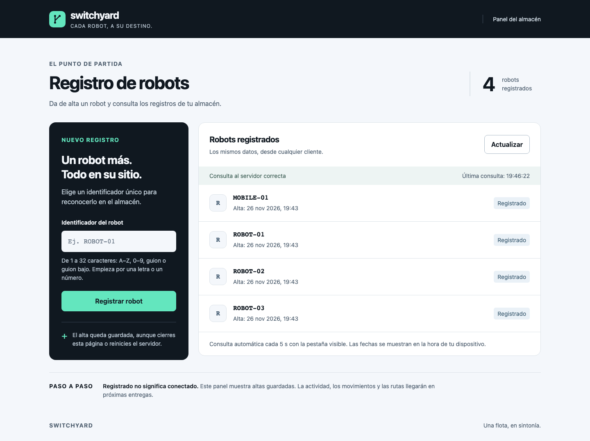
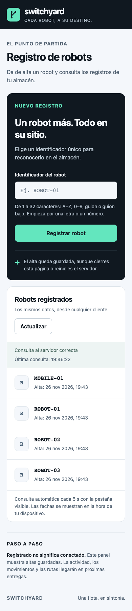
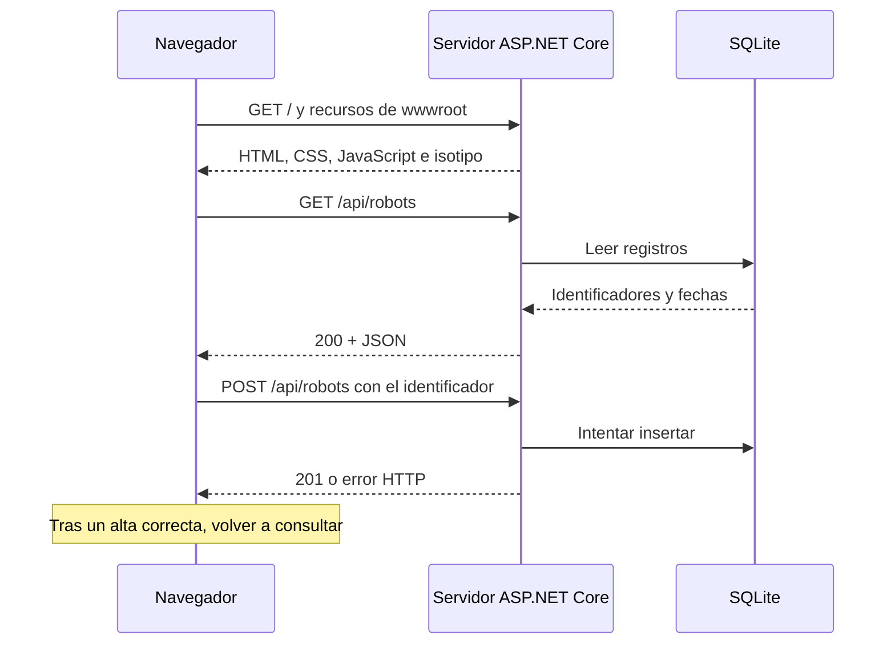

# 02 · Un panel para registrar y consultar robots

**Issue [#8](https://github.com/switchyard-project/switchyard/issues/8).** Esta entrega pone una interfaz sobre la funcionalidad de registro. Permite dar de alta un robot y ver las altas realizadas desde otros clientes, sin tener que leer JSON en el navegador.

El panel muestra datos reales de la API. No simula posiciones, actividad ni rutas; «registrado» significa que existe un alta guardada. El cliente de consola .NET sigue siendo un proceso independiente y conserva su función en el proyecto.

## Qué puede hacer una persona

1. Abrir la dirección del servidor en su navegador.
2. Escribir un identificador y registrar el robot.
3. Consultar los identificadores y sus fechas de alta.
4. Ver registros creados desde la consola o desde otro navegador en una próxima consulta.
5. Reconocer si la consulta ha fallado y los datos que está viendo pueden estar desactualizados.

La [guía de ejecución](../ejecucion.md) contiene los comandos. No hace falta instalar Node, un servidor de frontend ni otro paquete para abrir el panel: se sirve al arrancar la API.

Ver la adaptación a una pantalla estrecha

Las imágenes son capturas de esta entrega con registros de prueba. La segunda reproduce una pantalla estrecha en Chromium, no una prueba en un teléfono físico.

## Cómo viajan los datos

El navegador y la consola llaman a los mismos endpoints. El navegador no usa el repositorio C# ni abre SQLite. Tampoco guarda una copia de los registros en `localStorage`; la lista en pantalla es una instantánea de la última consulta correcta.

La interfaz utiliza `/api/robots`, una ruta relativa al origen que la sirve. Si abrimos el panel desde otro equipo, sus peticiones van al servidor que aparece en esa dirección, no a `localhost` del teléfono. Al compartir origen no necesitamos habilitar CORS para esta entrega.

## Archivos y responsabilidades

| Archivo | Qué hace |
| :--- | :--- |
| [Program.cs](../../src/Switchyard.Api/Program.cs) | Añade `UseDefaultFiles` y `UseStaticFiles` antes de los controladores. La raíz sirve `index.html`; `/api/robots` conserva su comportamiento. |
| [index.html](../../src/Switchyard.Api/wwwroot/index.html) | Define la estructura, el formulario, las etiquetas, los estados y una plantilla para cada registro. |
| [styles.css](../../src/Switchyard.Api/wwwroot/styles.css) | Aplica la identidad visual, el foco visible y la distribución adaptable. |
| [robot-api.js](../../src/Switchyard.Api/wwwroot/robot-api.js) | Envía HTTP, interpreta errores y comprueba la forma de las respuestas. No modifica elementos de la página. |
| [dashboard.js](../../src/Switchyard.Api/wwwroot/dashboard.js) | Coordina acciones de la persona, consultas periódicas y cambios visibles. |
| [WebDashboardTests.cs](../../tests/Switchyard.Tests/WebDashboardTests.cs) | Comprueba recursos públicos, tipos de contenido y rutas que deben seguir devolviendo `404`. |

El isotipo de `wwwroot/assets` es una copia del original de [identidad visual](../identidad-visual.md), incluida para servirlo sin exponer la carpeta de documentación. Si cambia el original, hay que actualizar esa copia.

## Funciones que conviene poder explicar

| Función | Trabajo y resultado |
| :--- | :--- |
| `requestJson` | Hace `fetch`, limita la espera a diez segundos, comprueba el código HTTP y lee JSON. Siempre libera el temporizador. |
| `isRobot` | Comprueba la estructura básica del registro recibido: identificador y fecha interpretable. |
| `getRobots` | Consulta el listado y rechaza respuestas que no sean un array de registros válidos. |
| `registerRobot` | Envía el identificador como JSON y comprueba que la respuesta corresponde a ese robot. |
| `updateControls` | Impide repetir el envío mientras está pendiente y cambia el texto de los botones durante las operaciones. |
| `renderRobots` | Clona la plantilla de cada fila, rellena texto y fecha y actualiza el total y el estado vacío. |
| `refreshRobots` | Coordina las lecturas: si ya hay una, devuelve su misma promesa; si se está enviando un alta, no inicia otra lectura. |
| `loadRobots` | Obtiene la lista, actualiza la hora de la consulta correcta o muestra el error conservando los últimos datos. |
| `submitRegistration` | Envía el alta, muestra el resultado y devuelve el foco al campo. Si se creó, espera una lectura anterior pendiente y solicita otra para ver el alta reciente. |

`currentRefresh` guarda una promesa mientras hay una consulta en curso y vuelve a `null` al terminar. Esto evita solapar lecturas y permite que el alta espere una consulta iniciada antes de la inserción. El temporizador y el botón utilizan la misma función.

## Decisiones de diseño

**HTML, CSS y JavaScript sin framework.** Hay un formulario y una lista; una cadena de compilación o un framework añadiría conceptos que todavía no necesitamos. La separación entre comunicación y pantalla deja margen para evolucionar el panel después.

**Archivos servidos por la API.** `UseDefaultFiles` resuelve el documento de entrada y `UseStaticFiles` sirve el contenido público de `wwwroot`. Los archivos de configuración, el código y SQLite permanecen fuera de esa carpeta. No añadimos una ruta de reserva que convierta cualquier URL desconocida de la API en una página HTML. [Documentación de ASP.NET Core](https://learn.microsoft.com/en-us/aspnet/core/fundamentals/static-files?view=aspnetcore-10.0).

**Consultas periódicas, no una conexión permanente.** Cada cinco segundos se intenta una lectura si la pestaña está visible y no hay otra operación que la impida. Al volver a la pestaña se solicita una consulta; también existe el botón **Actualizar**. La red puede retrasarla, así que no prometemos sincronización instantánea. SignalR o WebSocket se valorarán cuando la simulación necesite actualizaciones más frecuentes.

**Una respuesta de error no equivale a una lista vacía.** El total empieza en `—`. Solo mostramos cero después de recibir una lista vacía válida. Si falla una consulta posterior, mantenemos los últimos datos, el aviso y la hora de la última lectura correcta. No hay reintentos automáticos de las altas.

**`fetch` requiere comprobar el estado HTTP.** Un `409` o un `500` no rechaza por sí solo su promesa. `requestJson` comprueba `response.ok`, distingue errores previstos y usa `AbortController` para limitar la espera. Cancelar en el navegador no garantiza que el servidor no haya insertado el registro. [Uso de Fetch](https://developer.mozilla.org/en-US/docs/Web/API/Fetch_API/Using_Fetch).

**Validación en ambos extremos, con distinta función.** El HTML ayuda a corregir el identificador antes de enviarlo; el servidor sigue siendo quien lo valida y mantiene la unicidad. Se puede saltar el formulario y llamar a la API directamente, por lo que la validación del navegador nunca sustituye a la del servidor.

**Texto y fechas sin ejecutar HTML recibido.** Los identificadores se insertan con `textContent`, no con `innerHTML`. `Intl.DateTimeFormat` muestra las fechas en la zona horaria del dispositivo; el atributo `datetime` conserva el valor recibido. La API sigue almacenando UTC.

**Accesibilidad y pantalla estrecha desde el principio.** Hay etiquetas asociadas a los campos, mensajes con regiones de estado, foco visible y botones de al menos 46 píxeles de alto. La cuadrícula pasa a una columna. Los errores llevan texto y el estado no depende únicamente del color. Las pruebas automáticas de accesibilidad ayudan, pero no sustituyen una revisión con tecnologías de asistencia.

## Comprobación de esta entrega

Las ocho pruebas nuevas de .NET verifican la página inicial, CSS, ambos módulos JavaScript e isotipo, y que no se publiquen `Program.cs`, `appsettings.json` ni una ruta desconocida de la API. Se suman a las treinta pruebas anteriores del registro y del cliente .NET.

La comprobación del navegador es adicional: esas pruebas HTTP no ejecutan JavaScript. El 26 de noviembre de 2026 se comprobó con Chromium automatizado mediante Playwright, API real y base de datos temporal:

- Lista vacía y distinción entre vacío y fallo inicial.
- Validación del formulario, alta con teclado, recuperación del foco y duplicado sin otra fila.
- Alta desde el ejecutable .NET visible en una consulta periódica.
- Una lectura retrasada que empezó antes de un alta no deja el listado final sin ese registro.
- Fallo de red y respuesta de lista inválida: se conservan los datos y la consulta puede recuperarse.
- Alta desde una ventana estrecha, sin desbordamiento horizontal a 390 y 320 píxeles.
- Revisión visual de las capturas y comprobación con axe de reglas WCAG A/AA: sin infracciones detectadas en los estados examinados. No es una certificación de accesibilidad.

La CI ejecuta las pruebas .NET y el formato. Las comprobaciones de navegador se realizaron aparte; no hay todavía una suite de navegador instalada en el repositorio ni se exige Node para ejecutar la aplicación.

### Cómo repetir la parte principal a mano

1. Arranca la API con un archivo SQLite nuevo siguiendo la guía de ejecución.
2. Abre el panel; registra `WEB-01` con el teclado y repite el identificador para comprobar el conflicto.
3. Registra `CLI-01` desde la consola .NET y espera a que aparezca en el panel visible.
4. Detén la API y pulsa **Actualizar**: la lista permanece con un aviso de datos posiblemente desactualizados.
5. Reinicia con el mismo archivo y pulsa **Actualizar**: la consulta se recupera y los registros permanecen.
6. Reduce la anchura del navegador y repite un alta. Para validar el teléfono físico, sigue los pasos de acceso por red de la guía.

## Preguntas para la exposición

**¿El cliente ya no es .NET?**

El robot sigue siendo el ejecutable `Switchyard.Robot`. El panel es otro consumidor de la API, pensado para una persona. No sustituye al proceso de robot ni ejecuta su simulación.

**¿Hay que guardar los datos dos veces?**

No. Ambos clientes envían peticiones al mismo servidor y SQLite conserva el registro. El navegador solo dibuja lo que ha recibido.

**¿Por qué no veo inmediatamente un alta hecha desde otra ventana?**

Porque cada ventana consulta periódicamente. No hay un canal de notificaciones desde el servidor. La hora de la consulta y el botón de actualización hacen explícito ese comportamiento.

**¿Qué pasa si pulso dos veces o dos personas usan el mismo identificador?**

El botón se deshabilita durante el envío para evitar clics repetidos. La garantía real sigue estando en la clave primaria de SQLite y en la operación de alta: dos clientes diferentes no comparten el estado de ese botón.

**¿La página puede cancelar un alta que ha tardado mucho?**

Puede dejar de esperar la respuesta. Eso no deshace una escritura que el servidor ya haya completado; por eso hay que consultar antes de repetir una operación incierta.

**¿Un móvil obliga a cambiar de frontend?**

No. Puede abrir una web adaptable y comunicarse con el mismo servidor. Un mapa táctil, cuentas, permisos de edición y acceso remoto seguro son funcionalidades adicionales que habría que diseñar. La [propuesta móvil](../arquitectura.md#ampliación-opcional-acceso-desde-el-móvil) queda como objetivo opcional posterior a la demo principal.

**¿Ya hemos resuelto la colaboración entre empleado y revisor?**

No hay roles implementados. Las futuras acciones restringidas tendrán que autorizarse en la API, independientemente de qué botones enseñe la interfaz.
