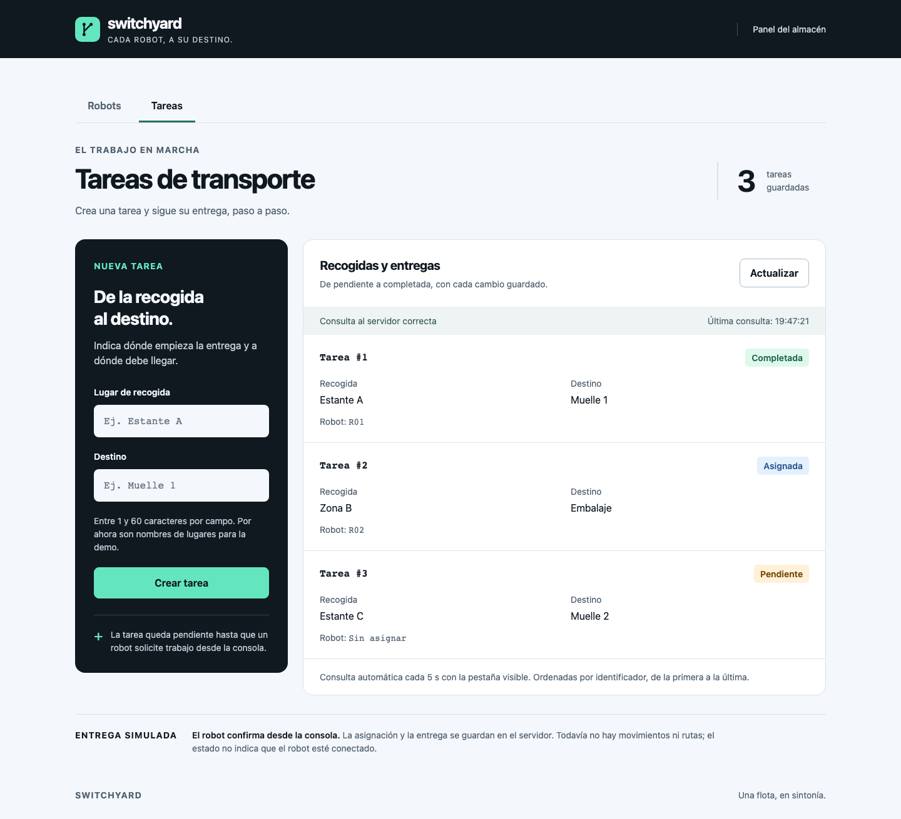
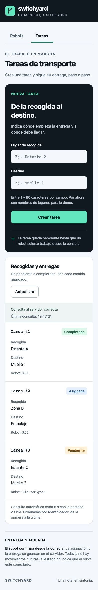
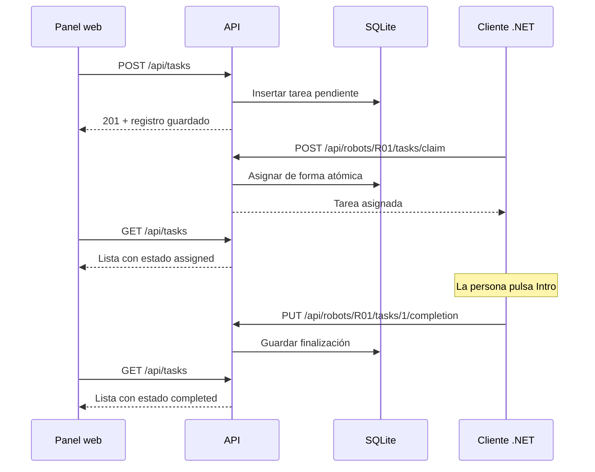

# 04 · Crear y seguir tareas desde el panel

**Issue [#14](https://github.com/switchyard-project/switchyard/issues/14).** La API y el cliente de Carlos ya podían crear, asignar y completar tareas. Esta entrega permite prepararlas desde el navegador y ver sus cambios sin tener que consultar cada identificador a mano.

La demo es: **crear en el panel → pedir trabajo desde .NET → ver «Asignada» → confirmar en la consola → ver «Completada»**. Se conserva el registro de robots y su panel. La asignación y la finalización siguen siendo operaciones del cliente robot.



<details>
<summary>Ver la adaptación a una pantalla estrecha</summary>



</details>

Son capturas de la aplicación usando una base temporal de demostración. La vista estrecha está reproducida en Chromium; no equivale a una prueba con un teléfono físico.

## Qué añade y qué conserva

- Una página **Tareas**, enlazada desde **Robots**, para crear recogidas y destinos.
- Un listado de todas las tareas con identificador, lugares, estado y robot asignado.
- Consulta manual y periódica de la página visible, aproximadamente cada cinco segundos si la red responde normalmente.
- El mismo comportamiento ante errores que el panel de robots: datos anteriores conservados, aviso y hora de la última consulta correcta.

No añade mapas, movimiento, rutas, autenticación ni permisos. Los lugares siguen siendo nombres de demostración. «Asignada» identifica un estado guardado, no una conexión activa del robot. El objetivo móvil con roles sigue siendo una ampliación opcional.

## Contrato HTTP

El endpoint nuevo es `GET /api/tasks`. Devuelve `200 OK`, `application/json` y un array ordenado por `id` ascendente. Incluye los tres estados, sin asignar ni completar nada al leer. Una base sin tareas devuelve `[]`.

```json
[
  {
    "id": 1,
    "pickup": "Estante A",
    "destination": "Muelle 1",
    "status": "assigned",
    "robotId": "R01"
  }
]
```

El formulario reutiliza `POST /api/tasks`: recogida y destino obligatorios, entre 1 y 60 caracteres, con contenido distinto de espacios. La API valida y recorta espacios de los extremos. Devuelve `201` con la tarea pendiente y `Location`. Las consultas individuales, reclamación de trabajo y confirmación se mantienen como en [la entrega de transporte](03-tareas-de-transporte.md).

El listado no tiene paginación en esta entrega: está pensado para la demo acotada. Antes de usarlo con un historial grande habrá que decidir límites y navegación de resultados.

## Recorrido de una entrega



El panel no escribe en SQLite ni conoce cómo se elige la siguiente tarea. La misma API que usa la consola sigue concentrando las reglas de asignación.

## Dónde está el código

| Archivo o método | Responsabilidad |
| :--- | :--- |
| [TransportTasksController.GetAll](../../src/Switchyard.Api/Controllers/TransportTasksController.cs) | Traduce el listado del repositorio a una respuesta HTTP `200`. |
| [TransportTaskRepository.GetAll](../../src/Switchyard.Api/Data/TransportTaskRepository.cs) | Ejecuta un `SELECT` con `ORDER BY id`, recorre el lector y reutiliza `ReadTask` para obtener el mismo contrato que las otras operaciones. |
| [tasks.html](../../src/Switchyard.Api/wwwroot/tasks.html) | Estructura accesible, formulario, estados de carga/error/vacío y plantilla de cada tarea. |
| [task-api.js](../../src/Switchyard.Api/wwwroot/task-api.js) | `getTasks` consulta y valida el array; `createTask` envía los dos campos y comprueba que el resultado sea la tarea pendiente esperada. |
| `isTask` en el mismo módulo | Comprueba campos, identificador representable con precisión en JavaScript, estado conocido y coherencia con el robot asignado. |
| [tasks-dashboard.js](../../src/Switchyard.Api/wwwroot/tasks-dashboard.js) | `renderTasks` dibuja identificador, lugares, estado y robot; configura las operaciones del panel compartido. |
| [http-client.js](../../src/Switchyard.Api/wwwroot/http-client.js) | `requestJson` hace HTTP con un límite de espera de diez segundos, comprueba estados y lee JSON. Recibe mensajes específicos de cada recurso. |
| [collection-panel.js](../../src/Switchyard.Api/wwwroot/collection-panel.js) | `mountCollectionPanel` conecta el formulario, las consultas y la representación de una lista. Cada página tiene su propia instancia y estado. |

Dentro de `mountCollectionPanel`:

- `updateControls` bloquea envíos repetidos y muestra cuándo se está guardando o consultando.
- `refresh` devuelve la lectura pendiente si ya existe una y evita nuevas lecturas durante un envío.
- `loadRecords` consulta, representa y actualiza la fecha; ante un error conserva los registros anteriores.
- `submit` recoge `FormData` **antes de deshabilitar los campos**, envía una sola creación y devuelve el foco al primer campo. Si la creación fue correcta, espera una lectura anterior y consulta de nuevo.

## Decisiones que conviene entender

**Reutilización motivada por dos usos reales.** Los paneles de robots y tareas necesitaban el mismo ciclo de lectura, envío y errores. Se comparte ese código, pero cada módulo conserva sus campos, mensajes y representación. No se añade un framework ni una abstracción genérica de persistencia.

**Dos páginas sencillas.** La navegación usa enlaces normales a `/` y `/tasks.html`. Al cambiar de página, el navegador destruye los temporizadores de la anterior. Cada página consulta únicamente su recurso. No necesitamos un router ni mantener vistas ocultas consultando datos.

**Orden y estados decididos por el servidor.** El panel muestra los estados recibidos como Pendiente, Asignada y Completada. No supone que una tarea se haya asignado por haber pulsado un botón. Los colores acompañan a las palabras y no son la única señal.

**El estado vacío es una respuesta válida.** Antes de la primera consulta, el total es `—`. Un error inicial no se representa como cero tareas. Si falla una consulta posterior o llega un estado desconocido, se mantiene la última lista, con un aviso de que puede estar desactualizada.

**Crear no es una operación deduplicada.** Dos tareas con los mismos lugares pueden ser legítimas. Si la API guarda una tarea pero se pierde su respuesta, el panel no reenvía automáticamente el POST y recomienda comprobar la lista. Todavía no hay una clave de operación que permita reconocer de forma inequívoca ese reintento.

**Una lectura antigua puede terminar después de una creación.** Por eso la creación espera la lectura pendiente antes de pedir otra. No se solapan consultas periódicas y no se deja como resultado final una lista obtenida antes del alta.

**Los nombres son datos, no HTML.** Se escriben mediante `textContent`. Un lugar que contenga etiquetas se muestra como texto. La validación del navegador ayuda a corregir errores; la API sigue validando cualquier cliente que llame directamente a sus endpoints.

## Demostración y comprobaciones

La [guía de ejecución](../ejecucion.md#demo-completa-del-panel-a-la-consola) describe la demo en macOS, Linux y Windows. Conviene partir de una base nueva para no confundir la tarea recién creada con otra anterior: el robot retoma primero su tarea activa y después pide la pendiente de menor identificador.

Las pruebas .NET comprueban el listado vacío, el orden de tareas en distintos estados, que consultar no cambia esos estados y que el listado conserva la información tras reiniciar. También se comprueban la nueva página y sus módulos como recursos HTTP. El total local de esta entrega es **54 pruebas correctas**; los resultados de CI se registran en el PR.

El 27 de noviembre de 2026 se comprobó además con Chromium automatizado, API real y base temporal:

- Registro de robots y rechazo de duplicados tras extraer los módulos compartidos.
- Creación con teclado, rechazo de campos con solo espacios y recuperación del foco.
- Cliente .NET como proceso independiente: solicitud de trabajo, espera de Intro y confirmación visibles en el panel por consulta periódica.
- Los tres estados mostrados juntos y mantenidos al recargar la página.
- Red caída y respuesta con estado desconocido: aviso, datos anteriores conservados y recuperación.
- Respuesta de creación perdida después de escribir en el servidor: un único POST y aviso de resultado incierto.
- Lectura antigua retrasada durante una creación y texto con etiquetas que no se ejecuta como HTML.
- Fallo inicial sin falso cero; pantallas de 320, 390, 700, 900 y 1024 píxeles sin desbordamiento horizontal.
- Revisión visual de capturas y axe sin infracciones detectadas en las reglas WCAG A/AA examinadas. No sustituye una auditoría completa ni una prueba en teléfono físico.

La CI ejecuta las pruebas .NET y el formato. Las pruebas de interacción se realizaron aparte, con herramientas temporales; Node no se añade como requisito para arrancar la aplicación.

## Preguntas para preparar la exposición

**¿Por qué añadir un listado si ya existía la consulta por identificador?** Porque el panel necesita descubrir todas las tareas sin adivinar sus identificadores ni guardar su propio inventario. Un listado permite recuperar la vista al abrir otra ventana.

**¿Quién puede asignar o completar desde el panel?** Esta interfaz no ofrece esas acciones. El cliente .NET las demuestra. Esto es una decisión de alcance, no una medida de autorización: la API aún no tiene cuentas ni permisos.

**¿Qué significa que dos clientes vean lo mismo?** Consultan el mismo estado persistido, pero sus instantáneas pueden corresponder a momentos distintos. La consulta periódica no garantiza actualización instantánea ni simultánea en todas las pantallas.

**¿Qué es una promesa aquí?** Representa el resultado futuro de una operación asíncrona. `currentRefresh` permite compartir la espera de una lectura en curso; no es un cerrojo distribuido ni equivale a calcular rutas en paralelo.

**¿Por qué no convertir ya el panel en una aplicación móvil?** La web adaptable ya prepara el acceso desde una pantalla pequeña. Las rutas táctiles, los roles y el acceso remoto seguro dependen de funcionalidades posteriores y siguen siendo opcionales.
