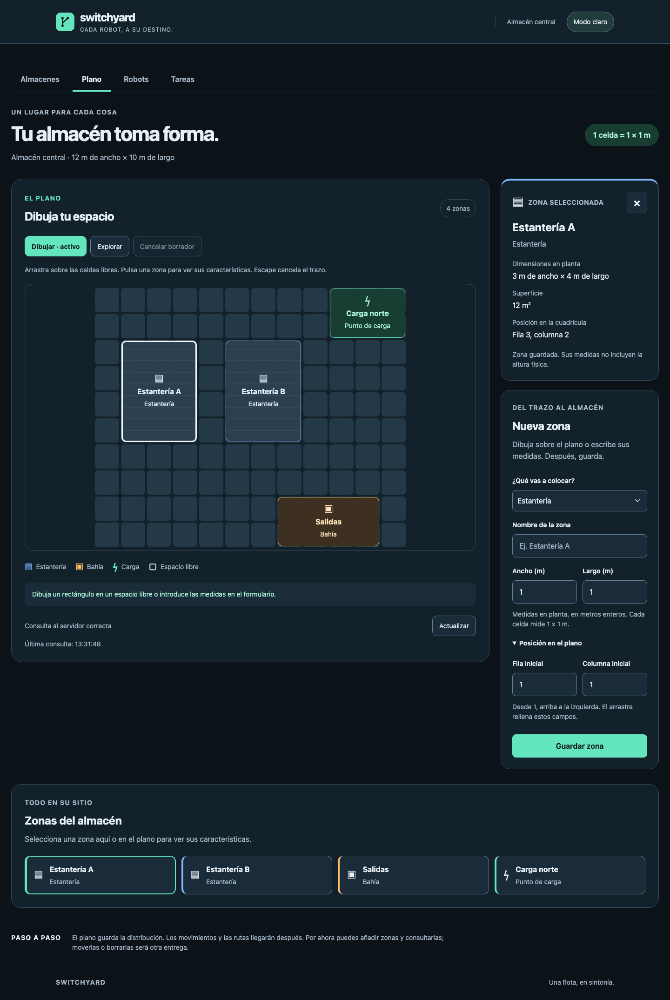

# 07 · Dibujar y consultar el almacén

El plano ahora se puede utilizar como una superficie de dibujo. Activa **Dibujar zona**, arrastra entre dos celdas libres y suelta: aparece un borrador con sus medidas. Elige un tipo, dale un nombre y pulsa **Guardar zona**. El formulario sigue disponible para introducir dimensiones y coordenadas con precisión.

Al pulsar una zona guardada se abre su ficha: nombre, tipo, ancho, largo, superficie y posición. También puedes seleccionarla en la lista inferior o llegar a sus botones con Tab y activarlos con Intro o Espacio. La ficha es de consulta; no modifica una zona ya guardada.

## Metros, celdas y posiciones

Cada celda representa **1 × 1 metro**. El ancho corresponde al número de columnas y el largo al número de filas. Una zona de 3 columnas por 2 filas mide 3 m de ancho, 2 m de largo y ocupa 6 m². Las posiciones siguen siendo índices de fila y columna, desde 1 en la esquina superior izquierda.

La medida es en planta: no expresa la altura física de las estanterías. Se admiten metros enteros, con un máximo de 50 × 50 m por almacén. La resolución es fija en esta entrega; no hay una escala configurable ni medidas fraccionarias.

El contrato JSON conserva `rows`, `columns`, `startRow` y `startColumn`. No cambia el almacenamiento ni se multiplican datos antiguos: se establece una escala de un metro por celda para interpretar la cuadrícula existente. Si cambiamos esa resolución en el futuro, habrá que introducirla explícitamente en el modelo, la interfaz y las conversiones.

## Comportamiento del editor

- El arrastre funciona en ambos sentidos y también permite seleccionar una sola celda. Si el puntero sale del plano, la selección se limita a sus bordes.
- El borrador rellena el formulario. Cambiar sus coordenadas o dimensiones actualiza la vista previa.
- Las zonas superpuestas y las medidas fuera de límites se señalan antes de enviar. El servidor sigue comprobándolas al guardar: otro cliente puede haber cambiado el plano.
- **Cancelar borrador** limpia la selección y sus coordenadas, conservando el nombre y el tipo. Escape durante un gesto vuelve al borrador anterior; fuera de un gesto cancela el borrador actual.
- En pantallas táctiles se empieza en **Explorar**. Este modo permite desplazar el plano. **Dibujar zona** reserva el gesto para dibujar; la página se puede desplazar desde fuera del plano.
- Un plano grande mantiene celdas utilizables dentro de un área desplazable. No se comprimen 50 columnas en una pantalla de teléfono.
- La consulta periódica conserva el borrador, la selección y el foco. No reconstruye todos los botones cada cinco segundos.
- Si falla un guardado, los datos del formulario permanecen. Una respuesta perdida puede corresponder a una zona ya guardada: consulta el plano antes de repetir.

## Recorrido del código

| Pieza | Métodos y responsabilidad |
| :--- | :--- |
| `warehouse-geometry.js` | `rectangleBetween` normaliza dos esquinas; `cellAtPoint` convierte píxeles a fila/columna y limita a los bordes; `placementError` comprueba dimensiones, límites e intersecciones. |
| `warehouse-map.js` | `mountWarehouseMap` crea la cuadrícula una sola vez. Gestiona Pointer Events, captura del puntero, modos y cancelación. |
| `showDraft` | Coloca la vista previa, explica sus dimensiones o el conflicto y evita crear filas/columnas CSS fuera del almacén. |
| `updateZones` | Añade o retira botones por ID sin reemplazar los que siguen existiendo. Conserva foco y selección. |
| `zoneButton` / `selectZone` | Presentan tipos con texto, símbolo y color; seleccionan la zona y solicitan su ficha. |
| `cancelGesture` | Libera la captura y recupera la selección anterior si el navegador cancela el gesto, se pierde el foco o se desplaza el contenedor durante el trazo. |
| `warehouse-dashboard.js` | Conecta plano, formulario y API. `readRectangle` lee las medidas; `showZoneDetails` presenta la ficha. |
| `collection-panel.js` | Mantiene el ciclo compartido de consulta y envío. Los callbacks opcionales `onCreated` y `onSubmittingChange` permiten limpiar el borrador tras éxito y bloquear el dibujo durante la escritura. Las otras páginas conservan su comportamiento. |
| `warehouse-editor.css` | Paleta del almacén conceptual, celdas redondeadas, tipos diferenciados, ficha y disposición adaptable. |

Los Pointer Events permiten utilizar el mismo recorrido para ratón, lápiz y tacto. La captura mantiene el seguimiento aunque el puntero abandone la celda inicial. `touch-action` cambia con el modo **antes** de iniciar el gesto, para que el navegador sepa si debe desplazar o dibujar. [Pointer Events](https://developer.mozilla.org/en-US/docs/Web/API/Pointer_events), [touch-action](https://developer.mozilla.org/en-US/docs/Web/CSS/touch-action).

## Preguntas para la exposición

**¿Arrastrar envía muchas peticiones al servidor?** No. Los movimientos solo cambian el borrador local. Se hace un POST al confirmar con Guardar zona.

**¿Por qué mantener el formulario?** Permite elegir medidas exactas, usar teclado y completar el trabajo sin depender de un gesto de precisión.

**¿Por qué validar dos veces?** La interfaz ayuda a corregir pronto. La API es la autoridad porque la información local puede estar desactualizada y otros clientes pueden enviar peticiones directamente.

**¿Qué pasa si otra persona ocupa el mismo sitio?** La escritura atómica del servidor rechaza la segunda zona. El formulario conserva el intento para corregirlo y la próxima consulta muestra el nuevo estado.

**¿El dibujo muestra rutas o robots en movimiento?** No. Es una distribución guardada del espacio. No atribuye actividad ni conectividad a los robots.

## Comprobación reproducible

La [suite de navegador](../../tests/browser/README.md) inicia una API real con SQLite temporal y comprueba arrastre, formulario, guardado, recarga, errores, teclado, consultas periódicas, interacción táctil emulada y planos grandes. Se ejecuta en la CI de Linux, junto a la compilación y las pruebas .NET. La revisión visual se ha realizado en escritorio y pantalla de 390 px. La emulación no sustituye una prueba en un teléfono físico y las comprobaciones automáticas de accesibilidad no cubren todas las necesidades de una persona.
