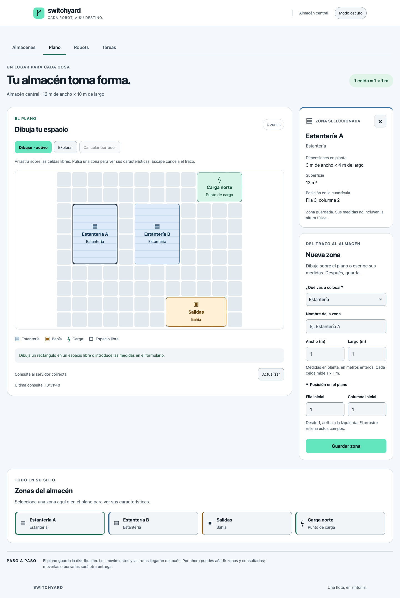
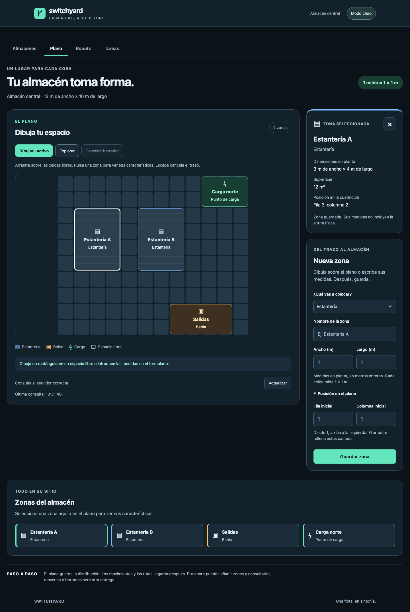

# 08 · Una misma aplicación, dos modos de color

El botón de la cabecera cambia entre **modo claro y modo oscuro**. Está disponible en Almacenes, Plano, Robots y Tareas. Cambia los fondos, textos, bordes, controles, mensajes, estados y colores del plano; cada página mantiene la misma paleta.

La primera visita sigue la preferencia del sistema. Cuando eliges un modo, el navegador lo recuerda al recargar y al pasar a otra página. Las pestañas abiertas del mismo origen también reciben el cambio.

| Modo claro | Modo oscuro |
| :---: | :---: |
|  |  |

El botón indica la acción que realizará: si estás en oscuro, dice «Modo claro». Su nombre accesible es «Activar modo claro», y viceversa. Se puede activar con teclado.

## Recorrido y decisiones

| Pieza | Responsabilidad |
| :--- | :--- |
| `theme.js` | Script común, cargado antes de las hojas de estilo de las cuatro páginas. |
| `readPreference` | Lee `switchyard.theme` de localStorage. Solo acepta `light` o `dark`; ante un valor inválido o almacenamiento bloqueado vuelve a la preferencia del sistema. |
| `applyTheme` | Establece `data-theme` en el elemento raíz y actualiza texto y nombre accesible del botón. No reconstruye formularios ni el plano. |
| Evento `change` de la consulta de medios | Sigue cambios del sistema mientras no exista una elección explícita. |
| Evento `storage` | Sincroniza otras pestañas del mismo origen cuando cambia o se elimina la preferencia. |
| Clic en el selector | Alterna, intenta persistir y aplica el modo. Si el navegador impide guardar, sigue funcionando en la página actual. |
| `theme.css` | Define colores por función: superficie, texto, control, borde, foco, éxito, aviso, error y tipos de zona. También establece `color-scheme` para los controles nativos. |
| `styles.css` y `warehouse-editor.css` | Consumen esas variables; no duplican una versión de cada componente para cada tema. |

Los colores semánticos evitan que una página use un gris de texto mientras otra utiliza el mismo gris como fondo. En claro, los textos secundarios siguen siendo oscuros sobre superficies claras. En oscuro se aclaran los textos y se mantienen superficies diferenciadas. Estantería, bahía y carga conservan su identidad azul, ámbar y menta, junto con nombre y símbolo.

El script se ejecuta al leer la cabecera para aplicar la elección antes del primer pintado habitual. No hay petición al servidor ni dependencia de una cuenta. El isotipo mantiene su color de marca en ambos modos.

## Preguntas para la exposición

**¿Por qué no guardar esto en SQLite?** Es una preferencia visual de este navegador, no estado compartido del almacén. No cambia el trabajo de los demás usuarios.

**¿Cambiar el modo pierde un borrador?** No: cambia variables CSS y un atributo. No vuelve a crear el editor, no modifica coordenadas ni envía una tarea.

**¿Qué ocurre si localStorage no está disponible?** Se toma la preferencia del sistema y el botón permite cambiar en la página actual. No se promete persistencia cuando el navegador impide almacenarla.

**¿Qué ocurre sin JavaScript?** La paleta por defecto es clara. El botón permanece oculto porque no puede funcionar; se mantiene el aviso existente sobre la necesidad de JavaScript para operar los paneles.

**¿Cómo se comprueba que todas las páginas están coordinadas?** Las pruebas recorren las cuatro vistas en ambos modos, verifican las superficies compartidas y comprueban contraste con axe. También se revisan capturas reales.

## Verificación

La [suite del navegador](../../tests/browser/README.md) comprueba preferencia del sistema, alternancia sin perder borrador o selección, persistencia entre páginas y recargas, sincronización entre pestañas y almacenamiento bloqueado. Recorre estados de tarea, fichas y controles en las cuatro páginas con ambos modos, comprueba pantalla estrecha y ejecuta reglas WCAG A/AA. El análisis automático no sustituye una auditoría completa de accesibilidad.
