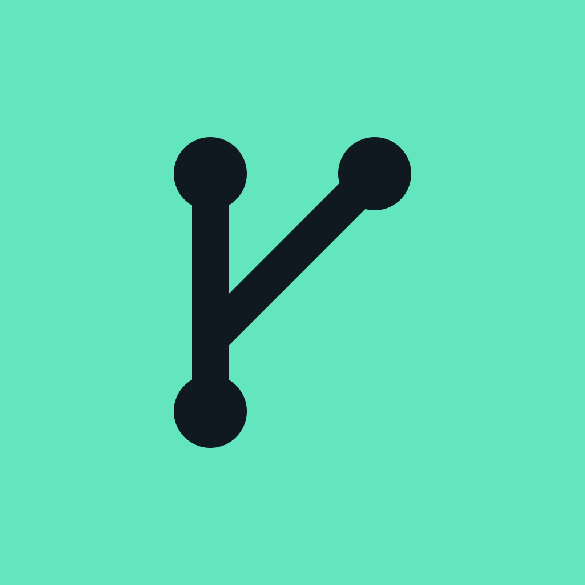
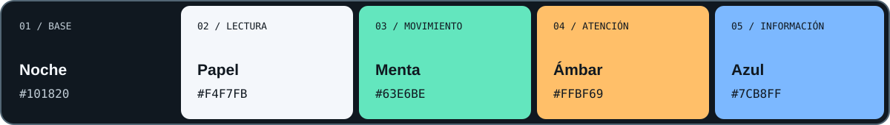

# Identidad visual

Switchyard toma su nombre de un patio ferroviario: un lugar donde se organizan recorridos, cambios de vía y esperas. La identidad traslada esa idea a un almacén de robots.

**Nombre:** Switchyard.

**Descripción:** Coordinación distribuida de robots autónomos.

**Lema:** Cada robot, a su destino. Una flota, en sintonía.

## Símbolo y estilo

El símbolo es un desvío con tres terminales, dibujado con líneas redondeadas. Los gráficos utilizan cuadrículas, recorridos y etiquetas breves, como un plano de circulación.

La voz del proyecto debe ser directa y cercana. Explicaremos primero qué sucede en el almacén y después cómo lo resuelve el código. Las capacidades previstas siempre se distinguirán de las implementadas.

## Isotipo listo para usar

<p align="center">
  
</p>

El isotipo es el símbolo de la marca sin el nombre. Mantiene el desvío de la cabecera, con proporciones adaptadas para que se reconozca como imagen pequeña. Los tres terminales representan distintos destinos conectados por una ruta común.

| Archivo | Para qué usarlo |
| :--- | :--- |
| [Avatar en PNG](assets/switchyard-avatar.png) | Imagen de perfil o icono. Cuadrado de 1024 × 1024 píxeles con fondo menta. |
| [Símbolo transparente en PNG](assets/switchyard-symbol.png) | Presentaciones y documentos con fondo claro. 1024 × 1024 píxeles. |
| [Avatar en SVG](assets/switchyard-avatar.svg) | Original vectorial con fondo, escalable y editable. |
| [Símbolo transparente en SVG](assets/switchyard-symbol.svg) | Original vectorial sin fondo, escalable y editable. |

El avatar tiene margen suficiente para que una plataforma lo recorte en círculo sin cortar el símbolo. Mantén la proporción cuadrada, no lo estires ni añadas texto dentro del icono. La versión transparente usa color noche: colócala sobre superficies claras.

### Volver a exportar los PNG

Los SVG son los originales. Los dos PNG se incluyen como recursos de marca listos para subir a servicios que no admiten SVG. Desde la raíz del repositorio, con `rsvg-convert` instalado, se regeneran así:

```bash
rsvg-convert -w 1024 -h 1024 docs/assets/switchyard-avatar.svg -o docs/assets/switchyard-avatar.png
rsvg-convert -w 1024 -h 1024 docs/assets/switchyard-symbol.svg -o docs/assets/switchyard-symbol.png
```

## Paleta



| Color | Hexadecimal | Uso propuesto |
| :--- | :--- | :--- |
| Noche | `#101820` | Fondo principal y texto sobre superficies claras. |
| Papel | `#F4F7FB` | Texto principal sobre oscuro y superficies claras. |
| Menta | `#63E6BE` | Identidad, rutas autorizadas y actividad. |
| Ámbar | `#FFBF69` | Esperas, reservas y situaciones que requieren atención. |
| Azul | `#7CB8FF` | Información del sistema y rutas secundarias. |

Para etiquetas sobre menta, ámbar o azul, usaremos texto noche. Los estados deben incluir también palabras o símbolos: una espera tiene que entenderse aunque no se distingan los colores. El primer panel aplica esta paleta y se ha revisado visualmente y con comprobaciones de contraste mediante axe; el [documento del panel](funcionalidades/02-panel-web.md) recoge el alcance de esa revisión. Los componentes nuevos necesitarán sus propias comprobaciones.

Los SVG usan una pila de fuentes de sistema (`Segoe UI`, Arial y sans-serif), sin descargas externas. Las cifras y códigos usan monospace.

## Recursos incluidos

- [Cabecera](assets/switchyard-banner.svg): presentación de la marca y símbolo.
- [Almacén conceptual](assets/warehouse-concept.svg): ejemplo ilustrado de rutas y una espera; no es una captura ni una validación de algoritmos.
- [Paleta](assets/switchyard-palette.svg): colores con sus nombres y valores.

Los originales son gráficos vectoriales editables; el isotipo incluye además las exportaciones PNG descritas arriba. Mantendremos los textos alternativos al insertarlos en documentos y evitaremos añadir dependencias externas para mostrar la identidad.
